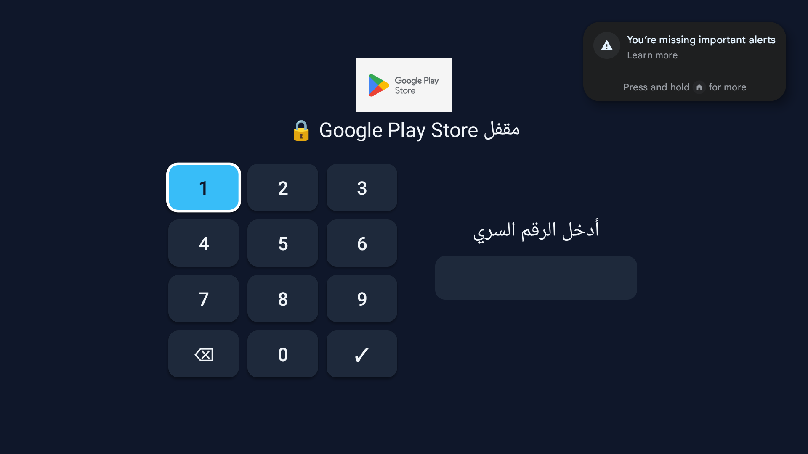
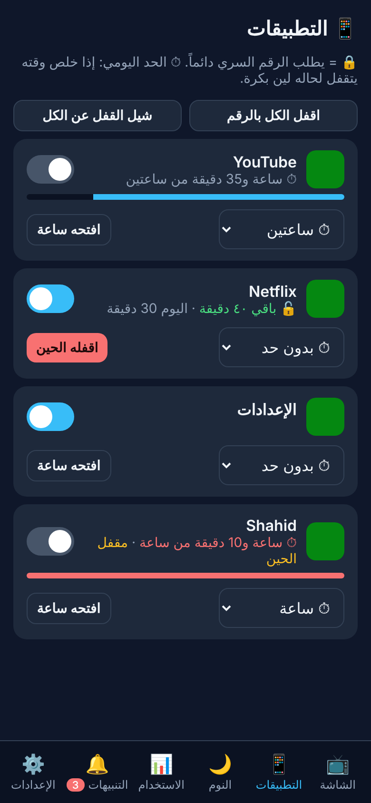
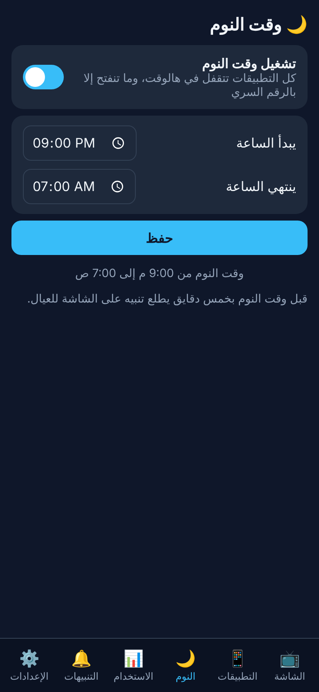
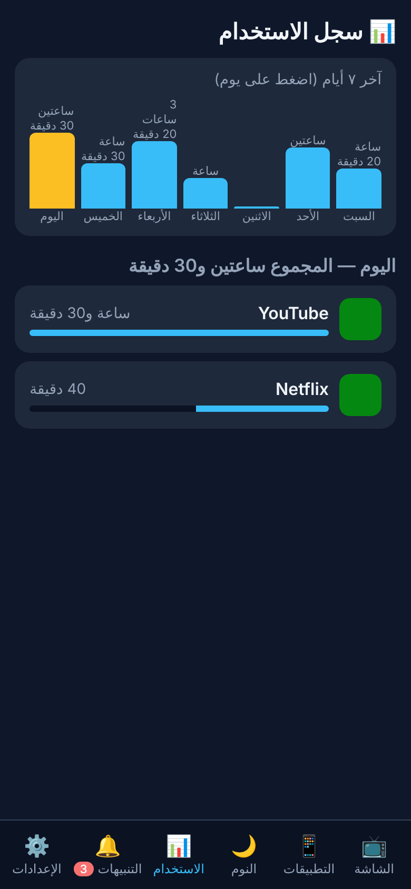

<div dir="rtl">

# 🔒 قفل التطبيقات لشاشات Google TV

تطبيق لشاشات **Android TV / Google TV** يقفل التطبيقات برقم سري، ويحدد وقت اللعب للعيال، ويعطيك **لوحة تحكم كاملة من جوالك** على شبكة البيت، وفيها بث مباشر للشاشة.

> صُمم وجُرّب على شاشة Xiaomi (Android 14). المفروض يشتغل على أي شاشة Android TV بنظام 5.0 أو أحدث، والبث المباشر يحتاج Android 11 أو أحدث.

<p align="center">
  <br>
  <em>شاشة القفل على التلفزيون</em>
</p>

---

## المحتويات

- [المميزات](#المميزات)
- [التثبيت السريع (ويندوز)](#التثبيت-السريع-ويندوز)
- [أول تشغيل](#أول-تشغيل)
- [طريقة الاستخدام على الشاشة](#طريقة-الاستخدام-على-الشاشة)
- [لوحة التحكم من الجوال](#لوحة-التحكم-من-الجوال)
- [إشعارات على الجوال (ntfy)](#إشعارات-على-الجوال-ntfy)
- [حدود معروفة](#حدود-معروفة)
- [الأمان والخصوصية](#الأمان-والخصوصية)
- [بناء التطبيق من الكود](#بناء-التطبيق-من-الكود)
- [حل المشاكل](#حل-المشاكل)
- [هيكل المشروع](#هيكل-المشروع)

---

## المميزات

| الميزة | الشرح |
|---|---|
| 🔒 **قفل برقم سري** | أي تطبيق تختاره يطلب الرقم السري قبل ما يفتح. الرقم يفتح على طول أول ما تكتب آخر رقم صحيح. |
| ⏳ **مدة الفتح** | بعد الرقم السري تختار: هذي المرة بس (يتقفل أول ما تطلع منه)، ربع ساعة، ساعة، ساعتين، ٣ ساعات، أو مفتوح لين تقفله بنفسك. |
| 🌙 **وقت النوم** | من ساعة لساعة (مثلاً ٩ م إلى ٧ ص) ينقفل كل شي، حتى التطبيقات اللي كانت مفتوحة. |
| ⏱ **حد يومي لكل تطبيق** | مثلاً يوتيوب ساعتين باليوم. إذا خلص الوقت يتقفل لين بكرة. |
| 📊 **سجل الاستخدام** | كم دقيقة انفتح كل تطبيق، لآخر ٧ أيام (يُحسب فقط والشاشة شغالة). |
| ⚠️ **عد تنازلي على الشاشة** | قبل القفل بـ٥ دقايق وبدقيقة يطلع تنبيه أصفر عشان ما ينقطع على العيال فجأة. |
| 🔔 **تنبيهات** | لما أحد يكتب الرقم غلط مرتين، أو يحاول يفتح تطبيق مقفل، أو يبدأ وقت النوم. وتوصلك على جوالك حتى والصفحة مسكّرة. |
| 📱 **لوحة تحكم من الجوال** | كل الإعدادات من جوالك على رابط داخلي، مع **بث مباشر للشاشة** وأزرار تحكم. |
| 📺 **اسم قناة Live TV** | القنوات المباشرة ما تنصوّر (حماية من الشاشة)، فالتطبيق يقرا اسم القناة ويعرضه لك بدال الصورة. |
| 🛡️ **حماية من التحايل** | الإعدادات ومتجر Play مقفلة افتراضياً عشان ما يقدر أحد يطفي الخدمة أو يحذف التطبيق. ٥ محاولات غلط توقف الإدخال دقيقة. |

---

## التثبيت السريع (ويندوز)

### ١. جهّز الشاشة

1. **الإعدادات ← النظام ← حول** واضغط على **«إصدار نظام التشغيل»** ٧ مرات لين يطلع لك «أنت الآن مطوّر».
2. **الإعدادات ← النظام ← خيارات المطوّرين** وشغّل **تصحيح الأخطاء عبر USB** و**تصحيح الأخطاء عبر الشبكة** (إذا موجود).
3. اعرف عنوان الشاشة من **الإعدادات ← الشبكة والإنترنت** (مثل `192.168.0.107`).

### ٢. جهّز الكمبيوتر

- لازم يكون عندك `adb`: إما مثبّت مع Android Studio، أو نزّل [Platform Tools](https://developer.android.com/tools/releases/platform-tools) وفك الضغط في مجلد `windows\adb\`.

### ٣. ثبّت

1. نزّل المشروع (زر **Code ← Download ZIP**) وفك الضغط.
2. افتح `windows\config.bat` بالمفكرة وعدّل `TV_IP` لعنوان شاشتك.
3. شغّل `windows\1-install.bat` بضغطتين.
4. أول مرة بتطلع على الشاشة رسالة **«السماح بتصحيح الأخطاء؟»**: اختر **السماح دائماً** ووافق.

> **بدون كمبيوتر؟** انقل ملف `dist/TVLock-*.apk` للشاشة بتطبيق مثل **Send Files to TV** وثبّته، وبعدها فعّل الخدمة يدوياً (الخطوة ٢ في أول تشغيل).

### سكربتات ويندوز

| الملف | وش يسوي |
|---|---|
| `1-install.bat` | يثبّت التطبيق ويشغّل خدمة القفل ويفتح التطبيق |
| `2-update.bat` | يحدّث لنسخة جديدة (يحفظ الإعدادات والرقم السري) |
| `3-screenshot.bat` | ياخذ لقطة للشاشة ويفتحها |
| `4-diagnose.bat` | يجمع معلومات التشخيص في `diagnose.txt` |
| `5-uninstall.bat` | يحذف التطبيق بالكامل |

---

## أول تشغيل

1. افتح **«قفل التطبيقات»** من الشاشة واختر رقم سري (٤ إلى ٨ أرقام) واكتبه مرتين.
2. إذا مكتوب **«⚠️ خدمة القفل مو مفعلة»** اضغط **تفعيل خدمة القفل** وشغّل «قفل التطبيقات» من إعدادات **إمكانية الوصول**. (سكربت التثبيت يسويها لك تلقائياً.)
3. اختر التطبيقات اللي تبيها مقفلة (🔒 مقفل / 🔓 مفتوح).
4. خذ الرابط المكتوب تحت **«📱 شوف الشاشة من جوالك»** وافتحه من جوالك.

---

## طريقة الاستخدام على الشاشة

**لما أحد يفتح تطبيق مقفل:** تطلع شاشة القفل. زر الرجوع يرجّعه للرئيسية. اكتب الرقم السري (بأسهم الريموت أو أزرار الأرقام) وبيفتح على طول، وبعدين اختر المدة.

**سبب القفل يظهر تحت اسم التطبيق:**
- بدون سبب = مقفل بالرقم السري دائماً.
- 🌙 وقت النوم.
- ⏱ خلص وقت اليوم.

**إعدادات التطبيق على الشاشة** (تحتاج الرقم السري كل مرة):
- قائمة التطبيقات المفتوحة الحين وزر «اقفله الحين» لكل وحدة.
- «اقفل كل التطبيقات الحين».
- تغيير الرقم السري.
- تشغيل/إيقاف لوحة الجوال.

---

## لوحة التحكم من الجوال

افتح من جوالك (وهو على **نفس شبكة البيت**):

```
http://<عنوان-الشاشة>:8787
```

ادخل بالرقم السري مرة وحدة، والجوال يتذكرك. (إذا غيّرت الرقم السري، كل الجوالات تطلع وتحتاج تدخل من جديد.)

<p align="center">
  
  
  
  
  
</p>

| التبويب | وش فيه |
|---|---|
| 📺 **الشاشة** | بث مباشر (صورة كل ثانية تقريباً)، التطبيق المفتوح وكم باقي له، واسم القناة إذا على Live TV. أزرار: اقفل الحالي، اقفل كل شي، الرئيسية، رجوع، إيقاف البث. وإذا طلعت شاشة القفل للعيال: **افتحه ربع ساعة / ساعة / هذي المرة** من جوالك. |
| 📱 **التطبيقات** | لكل تطبيق: قفل بالرقم، حد يومي (ربع ساعة لين ٤ ساعات)، استهلاك اليوم، وزر افتحه ساعة / اقفله الحين. |
| 🌙 **النوم** | تشغيل/إيقاف، ساعة البداية والنهاية. |
| 📊 **الاستخدام** | رسم آخر ٧ أيام. اضغط أي يوم تشوف كل تطبيق كم أخذ. |
| 🔔 **التنبيهات** | سجل المحاولات وتغيير الرقم والقنوات اللي انشافت، وإعداد إشعارات الجوال. |
| ⚙️ **الإعدادات** | حالة خدمة القفل، تغيير الرقم السري، تسجيل خروج. |

> 💡 **نصيحة:** في سفاري أو كروم اختر **«إضافة إلى الشاشة الرئيسية»** عشان تصير اللوحة مثل تطبيق على جوالك.

---

## إشعارات على الجوال (ntfy)

اللوحة تنبهك وهي مفتوحة. عشان توصلك الإشعارات **حتى والصفحة مسكّرة**، التطبيق يستخدم خدمة مجانية مفتوحة المصدر اسمها [ntfy](https://ntfy.sh):

1. نزّل تطبيق **ntfy** من App Store أو Google Play.
2. في اللوحة: **🔔 التنبيهات** ← شغّل **إشعارات على جوالك** وانسخ الاسم (مثل `tvlock-a1b2c3d4e5`).
3. في تطبيق ntfy اضغط **+** واشترك بنفس الاسم.
4. اضغط **إرسال تنبيه تجريبي**.

**وش يوصلك:** رقم سري غلط مرتين، ٥ محاولات غلط، محاولة فتح تطبيق مقفل (مرة كل دقيقتين لنفس التطبيق)، وبداية وقت النوم.

> ⚠️ الرسائل تمر على سيرفر ntfy.sh. الاسم هو اللي يحميها، فلا تشاركه مع أحد. وتقدر تغيّره لأي اسم صعب التخمين.

---

## حدود معروفة

| الحالة | السبب |
|---|---|
| **Live TV (القنوات) تطلع سودا في البث** | الشاشة تعرض فيديو القنوات مباشرة بدون ما يمر على أندرويد، فحتى أدوات النظام ما تقدر تصوّره. البديل: التطبيق يعرض **اسم القناة** (يتحدث لما يظهر شريط القناة، يعني مع تغيير القناة أو زر المعلومات). |
| **نتفلكس وشاهد وديزني وأمثالها** | هالتطبيقات تمنع التصوير عمداً. تشوف اسم التطبيق بس. |
| **الشاشة في وضع الاستعداد** | ما فيه شي يتصوّر، واللوحة تكتب «الشاشة مطفية». |
| **بعد إعادة تشغيل الشاشة** | بعض الشاشات توقف خدمات إمكانية الوصول. افتح التطبيق وتأكد إنه مكتوب «✅ خدمة القفل شغالة». |
| **الطفل الذكي 😄** | يقدر يطفي الخدمة من الإعدادات أو يعيد ضبط المصنع. خلي **الإعدادات** و**متجر Play** مقفلة. وإذا انطفت الخدمة، لوحة الجوال نفسها تتوقف عن الفتح، وهذي علامة إن أحد لعب فيها. |

---

## الأمان والخصوصية

- **كل شي محلي:** اللوحة تشتغل داخل الشاشة على المنفذ `8787` وما تطلع للإنترنت. ما فيه حسابات ولا سيرفرات (إلا ntfy إذا فعّلته أنت).
- **الرقم السري** محفوظ مشفّر (SHA-256) مو نص صريح.
- **حماية التخمين:** ٥ محاولات غلط توقف الإدخال دقيقة، على الشاشة وفي اللوحة.
- **الجلسة** بكوكي `HttpOnly` يتغيّر مع كل تغيير للرقم السري.
- الاتصال `http` (مو `https`) لأنه داخل شبكة البيت. لا تفتح المنفذ `8787` على الراوتر للإنترنت.
- صفحات التشخيص `/debug/*` ما تفتح إلا من داخل الشاشة نفسها (عن طريق `adb forward` من كمبيوترك).

---

## بناء التطبيق من الكود

ما يحتاج Android Studio ولا Gradle. البناء بأدوات خفيفة تنزل تلقائياً (لينكس x86_64، أو **WSL** على ويندوز):

```bash
# المتطلبات: Java 17+ و Python 3 و curl و unzip
pip install cryptography
./scripts/build.sh          # الناتج: dist/TVLock.apk
```

السكربت ينزّل الأدوات أول مرة في `tools/` من:
[Sable/android-platforms](https://github.com/Sable/android-platforms) (android.jar)،
[lzhiyong/android-sdk-tools](https://github.com/lzhiyong/android-sdk-tools) (aapt2، zipalign، adb)،
[pxb1988/dex2jar](https://github.com/pxb1988/dex2jar) (dx).

### مفتاح التوقيع ⚠️

- أول بناء ينشئ مفتاح في `keystore/tvlock.p12` (مستثنى من git).
- **لا تضيّع المفتاح:** التحديث فوق نسخة مثبتة لازم يكون بنفس المفتاح، وإلا لازم تحذف التطبيق (وتروح الإعدادات) وتثبّت من جديد.
- تقدر تحدد مفتاحك: `TVLOCK_KEYSTORE=/path/key.p12 TVLOCK_KEYPASS=xxx ./scripts/build.sh`

### عشان تغيّر رقم النسخة

عدّل `android:versionCode` (رقم يزيد كل مرة) و`android:versionName` في `app/AndroidManifest.xml`.

---

## حل المشاكل

<details>
<summary><b>التطبيقات ما تتقفل</b></summary>

- افتح التطبيق: إذا مكتوب «⚠️ خدمة القفل مو مفعلة» فعّلها، أو شغّل `windows\2-update.bat`.
- تأكد إن التطبيق مختار 🔒 في القائمة.
</details>

<details>
<summary><b>اللوحة ما تفتح من الجوال</b></summary>

- الجوال لازم يكون على نفس شبكة الشاشة (مو بيانات الجوال).
- اكتب العنوان كامل مع `http://` و`:8787`.
- تأكد إن «المشاهدة من الجوال» شغالة في إعدادات التطبيق على الشاشة.
- بعض الراوترات فيها «عزل العملاء» (AP/Client Isolation) يمنع الأجهزة تشوف بعض. طفّه من إعدادات الراوتر.
</details>

<details>
<summary><b>البث صورة سودا</b></summary>

- إذا Live TV أو نتفلكس وأمثاله: هذا طبيعي (شوف «حدود معروفة»).
- غير كذا: شغّل `windows\4-diagnose.bat` وشوف سطر `diag:` في `diagnose.txt`.
</details>

<details>
<summary><b>اسم القناة ما يطلع</b></summary>

غيّر القناة أو اضغط زر المعلومات (Info) في الريموت عشان يظهر شريط القناة. إذا ظل ما يطلع، شغّل `4-diagnose.bat`: في `diagnose.txt` تحت `live dump` تلقى النصوص اللي قراها التطبيق من شاشة القنوات. أرسلها في Issue عشان نضبط القراءة لشاشتك.
</details>

<details>
<summary><b>نسيت الرقم السري</b></summary>

ما فيه باب خلفي (عشان الأمان). احذف التطبيق بـ `windows\5-uninstall.bat` وثبّته من جديد. لو كانت **الإعدادات** مقفلة، هذا هو الحل الوحيد، وهو يحتاج كمبيوتر وتصحيح الأخطاء شغال.
</details>

<details>
<summary><b>«INSTALL_FAILED_UPDATE_INCOMPATIBLE» وقت التحديث</b></summary>

النسخة المثبتة موقعة بمفتاح مختلف. احذف القديمة (`5-uninstall.bat`) وثبّت من جديد، أو ابنِ بنفس المفتاح القديم.
</details>

---

## هيكل المشروع

```
app/
  AndroidManifest.xml
  assets/panel.html          لوحة الجوال (صفحة وحدة HTML/JS)
  res/                       الأيقونات وإعداد خدمة إمكانية الوصول
  src/com/hadi/tvlock/
    LockService.java         قلب التطبيق: يراقب التطبيق المفتوح، يقفل، يحسب الوقت، يصوّر، يقرا القناة
    LockActivity.java        شاشة الرقم السري واختيار المدة
    MainActivity.java        إعدادات التطبيق على الشاشة
    Rules.java               قواعد القفل: رقم سري / وقت نوم / حد يومي
    Store.java               حفظ الإعدادات
    Usage.java               سجل الاستخدام اليومي
    Events.java              التنبيهات وإرسالها لـ ntfy
    Apps.java                قائمة التطبيقات وأسماؤها وأيقوناتها
    WebServer.java           سيرفر اللوحة والـ API
    Ui.java                  عناصر واجهة مناسبة للريموت
scripts/                     سكربتات البناء والتوقيع
windows/                     سكربتات التثبيت والتحديث لويندوز
dist/                        ملف APK جاهز
docs/                        الشرح التقني والصور
```

📘 **للمطورين:** [docs/ARCHITECTURE.md](docs/ARCHITECTURE.md) (كيف يشتغل من الداخل) و[docs/API.md](docs/API.md) (واجهة اللوحة).

---

## الرخصة

[MIT](LICENSE). استخدمه وعدّل عليه بحرية.

</div>
