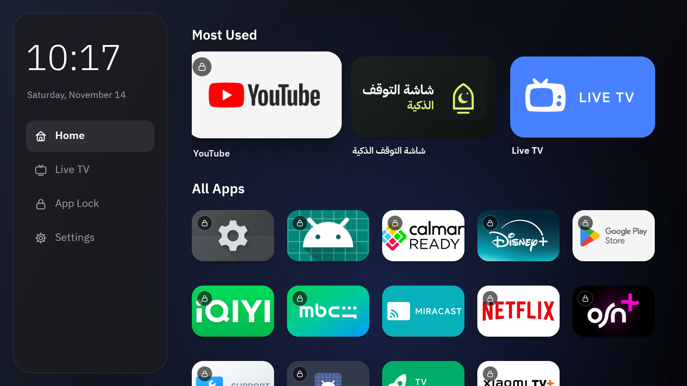
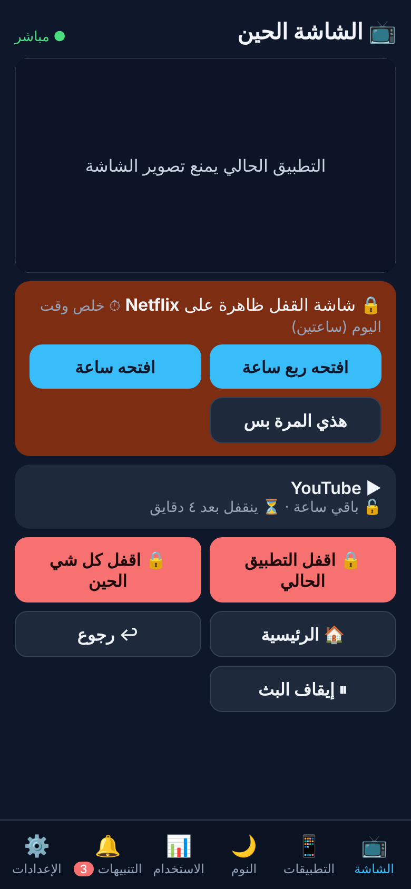
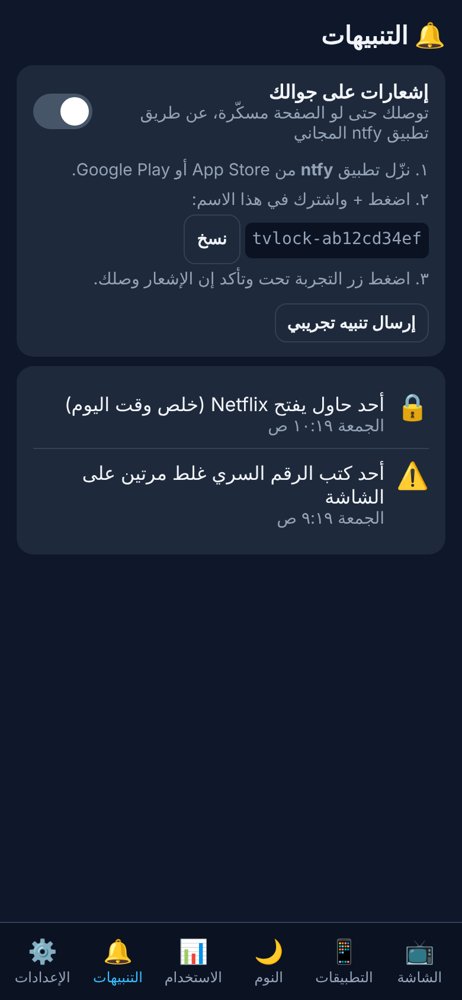

<p align="center"><b>English</b> · <a href="README.ar.md">العربية</a></p>

# 🔒 TV App Lock for Google TV

An app for **Android TV / Google TV** that locks apps behind a PIN, limits kids' screen time, replaces the cluttered home screen with a **clean, apps-only home screen**, and gives you a **full control panel on your phone** over your home Wi-Fi, including a live view of the TV screen.

> Designed and tested on a Xiaomi TV (Android 14). It should work on any Android TV running 5.0 or newer; the live screen view needs Android 11 or newer.

<p align="center">
  <br>
  <em>The home screen: apps only, no recommendations</em>
</p>

<p align="center">
  <br>
  <em>The lock screen on the TV</em>
</p>

---

## Contents

- [Features](#features)
- [Quick install (Windows)](#quick-install-windows)
- [First run](#first-run)
- [Home screen](#home-screen)
- [Using it on the TV](#using-it-on-the-tv)
- [Phone control panel](#phone-control-panel)
- [Push notifications (ntfy)](#push-notifications-ntfy)
- [Known limitations](#known-limitations)
- [Security and privacy](#security-and-privacy)
- [Building from source](#building-from-source)
- [Troubleshooting](#troubleshooting)
- [Project layout](#project-layout)

---

## Features

| Feature | Description |
|---|---|
| 🏠 **Clean home screen** | Apps only, in an Apple TV–like style: no recommendations, no "Continue watching", no ads. Most-used apps first, lock and time-left badges on each app. Follows the device language (Arabic right-to-left, English left-to-right). |
| 🔒 **PIN lock** | Any app you choose asks for the PIN before it opens. The app opens as soon as the last correct digit is entered. |
| ⏳ **Unlock duration** | After the PIN, choose: this time only (relocks as soon as you leave the app), 15 minutes, 1, 2 or 3 hours, or until you lock it yourself. |
| 🌙 **Bedtime** | Between two times (e.g. 9 PM to 7 AM) everything locks, including apps that were already unlocked. |
| ⏱ **Daily limit per app** | e.g. YouTube 2 hours a day. When the time is used up, the app locks until tomorrow. |
| 📊 **Usage history** | Minutes per app for the last 7 days (counted only while the screen is on). |
| ⚠️ **On-screen countdown** | A yellow banner 5 minutes and 1 minute before a lock, so kids aren't cut off without warning. |
| 🔔 **Alerts** | When someone enters a wrong PIN twice, tries to open a locked app, or bedtime starts. Delivered to your phone even when the panel is closed. |
| 📱 **Phone control panel** | All settings from your phone on a local link, with a **live view of the TV** and control buttons. |
| 📺 **Live TV channel name** | Live channels can't be captured (TV hardware protection), so the app reads the channel name and shows it instead. |
| 🛡️ **Tamper protection** | Settings and the Play Store are locked by default so nobody can switch off the service or uninstall the app. 5 wrong attempts block input for a minute. |

---

## Quick install (Windows)

### 1. Prepare the TV

1. **Settings → System → About**, click **"Android TV OS build"** 7 times until you see "You are now a developer".
2. **Settings → System → Developer options**: turn on **USB debugging** and **Network debugging** (if present).
3. Find the TV's address under **Settings → Network & Internet** (e.g. `192.168.0.107`).

### 2. Prepare the computer

- You need `adb`: either installed with Android Studio, or download [Platform Tools](https://developer.android.com/tools/releases/platform-tools) and unzip it into `windows\adb\`.

### 3. Install

1. Download the project (**Code → Download ZIP**) and unzip it, or grab the APK from [Releases](../../releases).
2. Open `windows\config.bat` in Notepad and set `TV_IP` to your TV's address.
3. Double-click `windows\1-install.bat`.
4. The first time, the TV asks **"Allow USB debugging?"**: choose **Always allow** and confirm.

> **No computer?** Copy `dist/TVLock-*.apk` to the TV with an app such as **Send Files to TV**, install it, then enable the service manually (step 2 of First run).

### Windows scripts

| File | What it does |
|---|---|
| `1-install.bat` | Installs the app, turns on the lock service and opens the app |
| `2-update.bat` | Updates to a new version (keeps settings and PIN) |
| `3-screenshot.bat` | Takes a screenshot of the TV and opens it |
| `4-diagnose.bat` | Collects diagnostic info into `diagnose.txt` |
| `5-uninstall.bat` | Restores the original home screen, then removes the app completely |
| `6-set-home.bat` | Makes the app's home screen the TV's home (rolls back automatically if it fails) |
| `7-restore-google-home.bat` | Brings back the TV's original home screen |

---

## First run

1. Open **"قفل التطبيقات" (App Lock)** on the TV, choose a PIN (4 to 8 digits) and enter it twice.
2. If it says **"⚠️ the lock service is not enabled"**, press **Enable lock service** and turn on "App Lock" in **Accessibility** settings. (The install script does this for you.)
3. Choose which apps to lock (🔒 locked / 🔓 open).
4. Note the link shown under **"📱 View the TV from your phone"** and open it on your phone.

> The TV interface is in Arabic. The phone panel and this guide explain every option.

---

## Home screen

<p align="center"></p>

A calm, apps-only home screen in the spirit of Apple TV:

- **Floating side panel:** clock, date, and four buttons with line icons: Home, Live TV, App Lock, Settings. A bedtime card at the bottom shows how long until bedtime (or a red warning if the lock service is off).
- **Most Used:** the three apps used most this week, as large cards.
- **All Apps:** full-image tiles with large rounded corners. The focused tile lifts and its name appears below it, like tvOS.
- **Badges:** a frosted lock on locked apps, and a time-left pill on apps with a daily limit (red when time is up).
- **Hide apps** you don't want on the home screen (system tools, apps the kids shouldn't see) from the phone panel: **Apps → 👁**.
- **Language:** follows the TV's language. Arabic is right-to-left; English is left-to-right.

### Turn it on

Run `windows\6-set-home.bat`. It checks that the new home screen starts, makes it the default, and disables the stock launchers (Google TV and, on Xiaomi, Mi Home) plus the Google TV setup wizard, which otherwise keeps claiming the Home button. If the Home button doesn't end up on the new screen, it puts everything back by itself.

### Turn it off

Run `windows\7-restore-google-home.bat`. **Always run it before uninstalling the app**, otherwise the TV is left with no home screen (a black screen). `5-uninstall.bat` does this for you.

---

## Using it on the TV

**When someone opens a locked app:** the lock screen appears. Back goes to the home screen. Enter the PIN (remote arrows or number keys) and it opens immediately, then choose a duration.

**The lock reason is shown under the app name:**
- No reason = always locked with the PIN.
- 🌙 Bedtime.
- ⏱ Today's time is used up.

**App settings on the TV** (PIN required every time):
- Apps currently unlocked, each with a "lock now" button.
- "Lock all apps now".
- Change PIN.
- Turn the phone panel on or off.

---

## Phone control panel

Open on your phone (on the **same home Wi-Fi**):

```
http://<tv-address>:8787
```

Sign in with the PIN once and the phone remembers you. (Changing the PIN signs every phone out.)

<p align="center">
  
  
  
  
  
</p>

| Tab | Contents |
|---|---|
| 📺 **Screen** | Live view (about one frame per second), the app in use and its time left, and the channel name on Live TV. Buttons: lock current app, lock everything, home, back, pause stream. When the kids hit the lock screen: **open for 15 min / 1 hour / this time** right from your phone. |
| 📱 **Apps** | For each app: PIN lock, daily limit (15 min to 4 hours), today's usage, show/hide on the home screen (👁), and open for an hour / lock now. |
| 🌙 **Bedtime** | On/off, start and end time. |
| 📊 **Usage** | Chart of the last 7 days. Tap a day to see time per app. |
| 🔔 **Alerts** | Log of attempts, PIN changes and channels watched, plus phone notification setup. |
| ⚙️ **Settings** | Lock service status, change PIN, sign out. |

> 💡 **Tip:** in Safari or Chrome choose **"Add to Home Screen"** so the panel opens like an app.

> The panel interface is in Arabic.

---

## Push notifications (ntfy)

The panel alerts you while it's open. To get notifications **even when the page is closed**, the app uses [ntfy](https://ntfy.sh), a free open-source service:

1. Install the **ntfy** app from the App Store or Google Play.
2. In the panel: **🔔 Alerts** → turn on **phone notifications** and copy the topic name (e.g. `tvlock-a1b2c3d4e5`).
3. In ntfy tap **+** and subscribe to the same name.
4. Tap **send test notification**.

**You'll be notified about:** a wrong PIN twice in a row, 5 wrong attempts, an attempt to open a locked app (at most once every 2 minutes per app), and the start of bedtime.

> ⚠️ Messages pass through the ntfy.sh server. The topic name is what protects them, so don't share it. You can change it to any hard-to-guess name.

---

## Known limitations

| Situation | Why |
|---|---|
| **Live TV shows black in the live view** | The TV renders tuner video directly on a hardware layer that bypasses Android, so even the system's own `adb screencap` can't capture it. Instead the app shows the **channel name** (updated whenever the channel banner appears: when changing channel or pressing Info). |
| **Netflix, Shahid, Disney+ and similar** | These apps block screenshots on purpose. You see the app name only. |
| **TV in standby** | There is nothing to capture; the panel says the screen is off. |
| **After the TV restarts** | Some TVs switch off accessibility services. Open the app and check it says "✅ the lock service is running". |
| **Lock screen and settings language** | The home screen follows the device language; the lock screen, the app settings on the TV and the phone panel are in Arabic. |
| **The clever kid 😄** | They could turn off the service in Settings or factory-reset the TV. Keep **Settings** and the **Play Store** locked. If the service is switched off, the phone panel stops loading, which is your sign someone tampered with it. |

---

## Security and privacy

- **Everything is local:** the panel runs inside the TV on port `8787` and never goes to the internet. No accounts, no servers (except ntfy, if you turn it on).
- **The PIN** is stored hashed (SHA-256), not in plain text.
- **Brute-force protection:** 5 wrong attempts block input for a minute, on the TV and in the panel.
- **Session** is an `HttpOnly` cookie that changes whenever the PIN changes.
- The connection is `http` (not `https`) because it stays inside your home network. Don't forward port `8787` on your router to the internet.
- The `/debug/*` pages only answer requests from the TV itself (through `adb forward` from your computer).

---

## Building from source

No Android Studio or Gradle needed. The build uses small tools that are downloaded automatically (Linux x86_64, or **WSL** on Windows):

```bash
# Requirements: Java 17+, Python 3, curl, unzip
pip install cryptography
./scripts/build.sh          # output: dist/TVLock.apk
```

On first run the script downloads the tools into `tools/` from:
[Sable/android-platforms](https://github.com/Sable/android-platforms) (android.jar),
[lzhiyong/android-sdk-tools](https://github.com/lzhiyong/android-sdk-tools) (aapt2, zipalign, adb),
[pxb1988/dex2jar](https://github.com/pxb1988/dex2jar) (dx).

### Signing key ⚠️

- The first build creates a key in `keystore/tvlock.p12` (excluded from git).
- **Don't lose the key:** an update over an installed copy must use the same key, otherwise you have to uninstall (losing settings) and reinstall.
- Use your own key with: `TVLOCK_KEYSTORE=/path/key.p12 TVLOCK_KEYPASS=xxx ./scripts/build.sh`

### Changing the version

Edit `android:versionCode` (must increase every release) and `android:versionName` in `app/AndroidManifest.xml`.

---

## Troubleshooting

<details>
<summary><b>Apps don't lock</b></summary>

- Open the app: if it says "⚠️ the lock service is not enabled", enable it, or run `windows\2-update.bat`.
- Make sure the app is marked 🔒 in the list.
</details>

<details>
<summary><b>The panel doesn't open on the phone</b></summary>

- The phone must be on the same network as the TV (not mobile data).
- Type the full address with `http://` and `:8787`.
- Make sure "view from phone" is on in the app's settings on the TV.
- Some routers have "AP/Client Isolation" that stops devices seeing each other. Turn it off in the router settings.
</details>

<details>
<summary><b>The live view is black</b></summary>

- On Live TV, Netflix and similar: this is expected (see Known limitations).
- Otherwise: run `windows\4-diagnose.bat` and check the `diag:` line in `diagnose.txt`.
</details>

<details>
<summary><b>The channel name doesn't show</b></summary>

Change channel or press Info on the remote so the channel banner appears. If it still doesn't show, run `4-diagnose.bat`: under `live dump` in `diagnose.txt` you'll find the text the app read from the TV's channel screen. Post it in an Issue so we can tune the reader for your TV.
</details>

<details>
<summary><b>I forgot the PIN</b></summary>

There's no back door (for security). Remove the app with `windows\5-uninstall.bat` and reinstall. If **Settings** is locked, this is the only way, and it needs a computer with debugging turned on.
</details>

<details>
<summary><b>"INSTALL_FAILED_UPDATE_INCOMPATIBLE" when updating</b></summary>

The installed copy was signed with a different key. Uninstall it (`5-uninstall.bat`) and reinstall, or build with the original key.
</details>

---

## Project layout

```
app/
  AndroidManifest.xml
  assets/panel.html          phone panel (single HTML/JS page)
  assets/fonts/              IBM Plex Sans Arabic (SIL Open Font License)
  res/                       icons and the accessibility service config
  src/com/hadi/tvlock/
    HomeActivity.java        the home screen (apps only, tvOS-like)
    IconView.java            line icons drawn in code
    LockService.java         core: watches the foreground app, locks, counts time, captures, reads the channel
    LockActivity.java        PIN screen and duration picker
    MainActivity.java        app settings on the TV
    Rules.java               lock rules: PIN / bedtime / daily limit
    Store.java               saved settings
    Usage.java               daily usage log
    Events.java              alerts and ntfy delivery
    Apps.java                installed apps, names and icons
    WebServer.java           panel server and API
    Ui.java                  remote-friendly UI widgets
scripts/                     build and signing scripts
windows/                     install and update scripts for Windows
dist/                        ready-to-install APK
docs/                        technical docs and images
```

📘 **For developers:** [docs/ARCHITECTURE.md](docs/ARCHITECTURE.md) (how it works inside) and [docs/API.md](docs/API.md) (panel API).

---

## What's new

**2.5**
- New apps-only home screen in an Apple TV–like style, following the device language.
- Hide any app from the home screen from the phone panel.
- `6-set-home.bat` / `7-restore-google-home.bat`; `5-uninstall.bat` restores the original home first.

**1.8**
- First public release: PIN lock, bedtime, daily limits, usage history, alerts, countdown, phone panel with live view, Live TV channel name.

---

## License

[MIT](LICENSE). Use it and change it freely.

The bundled font [IBM Plex Sans Arabic](https://github.com/IBM/plex) is © IBM Corp. under the [SIL Open Font License](app/assets/fonts/OFL.txt).
